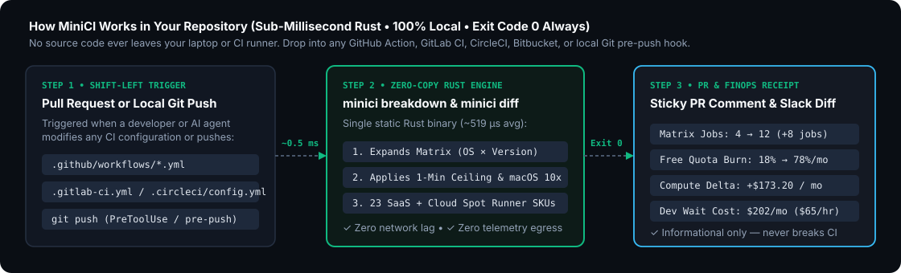

# MiniCI

**Sub-millisecond CI/CD FinOps CLI, Pull Request Cost Diff Action, `@minici` Bot, and MCP Server.**

[](https://github.com/Aamir-raza-1/minici-cost-action/actions/workflows/ci.yml)
[](https://github.com/Aamir-raza-1/minici-cost-action/releases/latest)
[](crates/minici/Cargo.toml)
[](docs/CAPABILITIES_AND_LIMITATIONS.md)
[](LICENSE)

[Installation](#installation) · [GitHub Action Quickstart](#github-action-quickstart) · [CLI Reference](#cli-reference) · [PR & Slack Bot](#pull-request--slack-bot) · [MCP Server](#mcp-server-for-ai-agents) · [Security](SECURITY.md) · [Documentation](docs/INSTALL_AND_USAGE.md)

---

`minici` expands CI/CD workflow matrices locally in **under 2 milliseconds** with zero external Rust crates, zero required API keys, and zero source-code egress. It audits pipelines across **7 CI/CD platforms** (`GitHub Actions`, `GitLab CI`, `CircleCI`, `Bitbucket Pipelines`, `AWS CodeBuild`, `Google Cloud Build`, and `Azure Pipelines`) and **150+ cloud VM types** (`AWS EC2`, `GCP Compute Engine`, and `Azure Virtual Machines`), producing a unified **24-model FinOps receipt**:

- **Pull Request Cost Diffs (`minici diff`):** Catch unintentional `OS × version × shard` matrix spikes, whole-minute ceiling rounding overhead, and macOS `10x` quota burn before merging (`exit 0` informational).
- **Surgical YAML Optimization (`minici shrink` & `minici migrate`):** Generate or apply comment-preserving workflow fixes (`concurrency`, `timeout-minutes`, shallow clones, artifact retention) and 6-gate verified `ARM64` or `7x7` cross-platform migrations.
- **Progressive Telemetry Reconciliation (`5` Tiers):** Start 100% offline from workflow YAML, then optionally layer read-only CI run telemetry (`ETag 304` cached), `FOCUS v1.1` / vendor billing CSVs, and local kernel CPU/RAM sampling ([`telemetry-step`](telemetry-step/action.yml)).
- **Agent-Native (`minici mcp` & `minici ask`):** Built-in `8`-tool JSON-RPC 2.0 stdio MCP server (NDJSON and LSP `Content-Length`) plus natural-language FinOps intent routing grounded in deterministic Rust math.

[](https://minici-cost-action.raza-aamir01.workers.dev/how-to-install-and-use.mp4)

> **Interactive Calculator:** [minici-cost-action.raza-aamir01.workers.dev](https://minici-cost-action.raza-aamir01.workers.dev) · **Terminal Recording:** [`web/how-to-install-and-use.mp4`](web/how-to-install-and-use.mp4) · [`web/how-to-install-and-use.cast`](web/how-to-install-and-use.cast)

---

## Architecture



- **Zero External Runtime Dependencies:** [`crates/minici/Cargo.toml`](crates/minici/Cargo.toml) compiles strictly against the Rust standard library (`std`). All `77` hosted CI runner SKUs and `150` cloud VM instance rates across `26` regions are embedded directly into the single static binary (`~1.6 MiB`).
- **Strict Applicability Filtering:** Only surfaces cost components and recommendations that apply to your repository (e.g., artifact storage appears only when `upload-artifact` steps exist; VPC/NAT egress appears only on self-hosted cloud runners).

---

## Installation

### Prebuilt Binary (`Linux` & `macOS`, SHA-256 Verified)

```bash
curl -fsSL https://raw.githubusercontent.com/Aamir-raza-1/minici-cost-action/main/scripts/install.sh | bash
```

Prebuilt release archives (`x86_64` and `aarch64` for Linux/macOS, plus `x86_64` Windows `.exe` and `SHA256SUMS.txt`) are available on the [Releases](https://github.com/Aamir-raza-1/minici-cost-action/releases/latest) page.

### Cargo / Build from Source (`~1.5s`, Offline-Capable)

```bash
# Install via Cargo
cargo install --git https://github.com/Aamir-raza-1/minici-cost-action.git minici

# Or build directly from source (zero crates downloaded)
git clone https://github.com/Aamir-raza-1/minici-cost-action.git
cd minici-cost-action
cargo build --release --manifest-path crates/minici/Cargo.toml
```

---

## GitHub Action Quickstart

Add `.github/workflows/minici-cost.yml` to any repository (or scaffold automatically via `minici init-hooks --path .`):

```yaml
name: CI Cost Receipt
on:
  pull_request:
  push:
    branches: [main]

permissions:
  contents: read
  pull-requests: write

jobs:
  ci-cost:
    runs-on: ubuntu-latest
    steps:
      - uses: actions/checkout@v4
        with:
          fetch-depth: 0 # Needed when comparing against origin/main

      - name: Run MiniCI Cost Breakdown & PR Diff
        id: cost
        uses: Aamir-raza-1/minici-cost-action@v1
        with:
          path: "."
          compare-to: "origin/main"
          tier: "auto"
          prs-per-week: "25"
          pushes-per-pr: "4"
          dev-hourly-rate: "65"
          post-pr-comment: "true"
```

### Action Inputs & Selected Outputs (`action.yml`)

| Input | Default | Description |
| :--- | :---: | :--- |
| `path` | `.` | Repository root or workflow directory |
| `compare-to` | `""` | Base Git ref (e.g., `origin/main`) to compute a Pull Request cost delta |
| `tier` | `auto` | Quota tier (`auto`, `free`, `pro`, `team`, `enterprise`, or `paid`) |
| `prs-per-week` | `25` | Weekly pull request volume for monthly run-rate projection |
| `pushes-per-pr` | `4` | Average pushes per pull request |
| `dev-hourly-rate` | `65` | Engineering hourly rate (`USD`) for critical-path wait-time calculation (`0` disables) |
| `live-telemetry` | `false` | Sync live CI run durations (`ETag 304` cached) prior to calculation |
| `billing-csv` | `""` | Optional `FOCUS v1.1` or CI vendor billing CSV/TSV path for invoice reconciliation |
| `post-pr-comment` | `false` | Create or update an idempotent sticky PR comment (`<!-- minici-cost-comment -->`) |

| Output (`steps.<id>.outputs.*`) | Description |
| :--- | :--- |
| `gross_monthly_compute_cost_usd` | Gross monthly CI/CD compute cost (`USD`) |
| `net_billed_monthly_compute_cost_usd` | Net billed monthly compute cost after plan/free-tier quota (`USD`) |
| `monthly_rounding_tax_usd` | Monthly whole-minute ceiling rounding overhead (`USD`) |
| `monthly_productive_payroll_loss_usd` | Monthly developer wait-time cost at `40%` DORA context-switch factor (`USD`) |
| `arm64_migration_monthly_savings_usd` | Monthly savings from migrating eligible Linux `x86_64` jobs to `ARM64` (`USD`) |
| `cost_per_merged_pr_usd` | Unit economics CI cost per merged pull request (`USD`) |
| `spend_anomaly_alert_active` | `true` when 7-day burn velocity exceeds `1.50x` prior 23-day baseline |
| `provenance_mode` | Data source (`static_heuristic`, `live_telemetry`, or `invoice_reconciled`) |
| *(+ 26 additional outputs)* | All `34` FinOps outputs defined in [`action.yml`](action.yml); optional kernel sampler in [`telemetry-step/action.yml`](telemetry-step/action.yml) |

---

## CLI Reference

```bash
# 1. Unified 24-model repository cost, quota & unit-economics receipt (< 2 ms)
minici breakdown --path .

# 2. Audit any public GitHub repository remotely without cloning
minici breakdown --repo astral-sh/uv
minici breakdown --repo open-webui/open-webui --refresh

# 3. Compare branch workflow changes against main before opening a PR
minici diff --path . --compare-to main

# 4. Preview or apply surgical comment-preserving YAML optimizations
minici shrink --path .
minici shrink --path . --apply

# 5. Evaluate 6-gate ARM64 runner right-sizing or 7x7 cross-platform migration
minici migrate --path . --to github-arm64
minici migrate --path . --from gitlab-ci --to github-actions

# 6. Ask natural-language FinOps questions backed by deterministic math
minici ask "Why is developer wait time high and how much can ARM64 save?" --path .

# 7. Reconcile live telemetry or FOCUS v1.1 / vendor billing exports
minici telemetry pull --repo owner/repo
minici sync --path . --billing-csv ./billing-export.csv
minici permissions check --repo owner/repo

# 8. Export standalone HTML, JSON, Markdown, or CSV reports
minici breakdown --path . --report ci-cost-report.html
minici breakdown --path . --format json --out-file ci-cost.json --quiet

# 9. Inspect runner/cloud pricing across AWS, GCP & Azure regions
minici cloud-price m5.large --region us-east-1
minici catalog --filter arm64
```

| Subcommand | Purpose |
| :--- | :--- |
| `breakdown` | Compute 24-model CI/CD cost, quota burn, and unit-economics receipt (`table`, `markdown`, `json`, `html`, `csv`) |
| `diff` | Compare base vs. head Git refs or directories to quantify Pull Request matrix & cost deltas |
| `shrink` | Generate or apply comment-preserving YAML optimizations (`--apply`, `--suggest-pr`) with shadow diff verification |
| `migrate` | Run 6-gate runner right-sizing (`github-arm64`, `ubuntu-slim`, `aws-spot`) and `7x7` cross-vendor pipeline translation |
| `ask` | Answer natural-language CI FinOps questions via intent routing + optional `/v1/systemone` neural disambiguation |
| `comment` | Render or post idempotent GitHub sticky PR comments and Slack Block Kit webhook notifications |
| `permissions` | Audit read-only token posture (`Contents: None` default) and progressive `108`-attribute telemetry coverage |
| `sync` | Sync `ETag 304` live run telemetry or billing CSVs into `.minici/telemetry.lock.json` |
| `telemetry` | Pull normalized historical run CSVs from GitHub Actions, GitLab CI, CircleCI v2, or Bitbucket Pipelines |
| `catalog` | List, filter, sync, or override runner and cloud SKU pricing (`~/.minici/pricing_overrides.json`) |
| `cloud-price` | Query On-Demand and Spot VM pricing across AWS EC2, GCP Compute Engine, and Azure Virtual Machines |
| `mcp` | Launch the `8`-tool JSON-RPC 2.0 stdio MCP server for AI coding agents and IDEs |
| `init-hooks` | Scaffold `.minici/hooks.json`, `.mcp.json`, and `.github/workflows/minici-cost.yml` |
| `self-update` | Sync catalog overrides, verify zero SKU drift, and update the local `minici` binary |
| `launch-pack` | Export structured repository FinOps summary profiles |

---

## Pull Request & Slack Bot

- **Interactive `@minici` GitHub PR Bot ([`.github/workflows/minici-pr-bot.yml`](.github/workflows/minici-pr-bot.yml)):** Automatically posts a sticky PR cost receipt on pull requests and responds to `@minici breakdown`, `@minici diff`, `@minici shrink`, `@minici migrate arm64`, `@minici permissions`, and `@minici why` comments with committable GitHub `suggestion` blocks.
- **Slack Notifications:** Deliver Block Kit receipts directly from CI with `minici comment slack --webhook-url "$SLACK_WEBHOOK_URL"` (zero external server required), or optionally deploy [`worker.js`](worker.js) for interactive two-way `/minici` slash commands.

---

## MCP Server for AI Agents

Register `minici` in `.mcp.json` (compatible with Claude Code, Antigravity, Cursor, Windsurf, and VS Code; supports both newline-delimited JSON and LSP `Content-Length` framing):

```json
{
  "mcpServers": {
    "minici": {
      "command": "minici",
      "args": ["mcp", "--path", "."]
    }
  }
}
```

**Exposed Tools (`8`):** `minici_breakdown`, `minici_diff`, `minici_sync_live`, `minici_permissions`, `minici_anomalies`, `minici_shrink`, `minici_migrate`, and `minici_ask`.

---

## Duration Estimation & Known Boundaries

When running in offline static mode (`< 2 ms`), `minici` estimates job runtime from workflow step signals (`+0.50m` VM boot, `+0.35m` checkout/artifact I/O, `+2.50m` test suites, `+3.50m` container/release builds, `+0.25m` standard steps), applies each provider's exact billing rounding (`ceil(mins)` per job on GitHub Actions and Bitbucket; fractional minutes on GitLab, CircleCI, and Cloud Build), and traverses `needs:` DAGs for critical-path wait time.

- **Pinning Exact Job Duration:** Add `# est-minutes: 18` (or `est-minutes: 18`) to any job in YAML, or pass `--live` / `--billing-csv` to use measured run history.
- **Git Depth for `diff`:** Always configure `fetch-depth: 0` on `actions/checkout@v4` when running `minici diff --compare-to origin/main` in CI so the base ref is present locally.
- **Static Analysis Scope:** Runtime-evaluated expressions (`strategy: matrix: ${{ fromJSON(...) }}`), YAML merge anchors (`<<: *base`), and cross-repository reusable workflows cannot be expanded statically without live execution telemetry and default to `1x` job cardinality. See [`docs/CAPABILITIES_AND_LIMITATIONS.md`](docs/CAPABILITIES_AND_LIMITATIONS.md) and [`docs/BENCHMARK_217_CASES_3ARM_RESULTS.md`](docs/BENCHMARK_217_CASES_3ARM_RESULTS.md) for full details.

---

## Security & License

`minici` requires **`Contents: None`** (`0` application source-code permissions) for local checkouts and public repositories, enforces SHA-256 verification on prebuilt binaries, and ships with zero third-party Cargo crates. See [`SECURITY.md`](SECURITY.md) for the full 5-tier read-only permission model.

Licensed under [Apache-2.0](LICENSE) · Created by [Aamir Raza](https://github.com/Aamir-raza-1).
