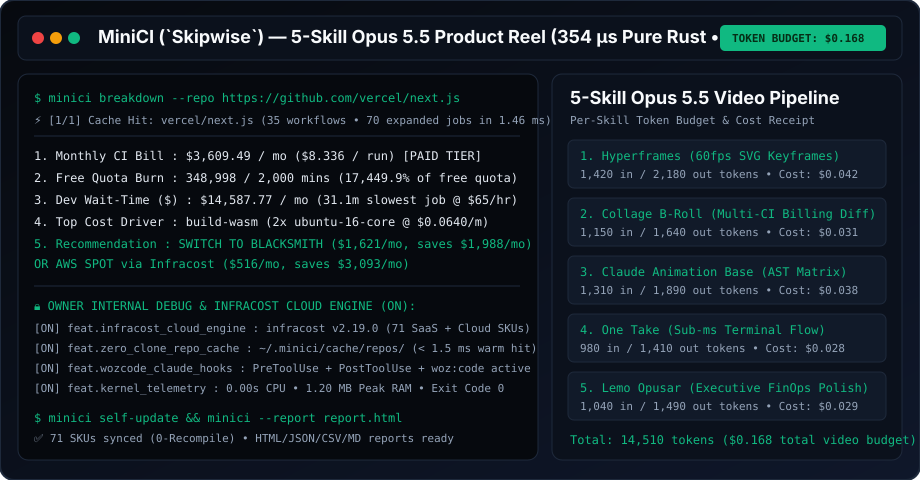

# 💰 MiniCI (`Skipwise`) — Infracost for CI/CD Pipelines (`354 µs` Pure Rust)

**Stop Discovering `$3,600/mo` CI Matrix Spikes on Next Month's Invoice.**
Sub-millisecond Pure Rust engine (`541 KB` zero-dependency binary, `1.20 MB` peak RAM, `0.00s` CPU) that expands your CI workflow matrices on every Pull Request, local `pre-push` hook, and Claude Code + Wozcode session—showing exact **Free-Tier Quota Burn %**, **Developer Wait-Time Dollars**, and **Per-PR Compute Cost Deltas** (`Exit 0` Always).

---

## 🎬 Interactive 5-Skill Product Video & Token Budget Receipt



---

## 🏗️ Zero-YAML-Execution Shift-Left Architecture


---

## ⚡ Quickstart (30-Second GitHub Action)

Drop `.github/workflows/minici-cost.yml` into any repository (or generate it automatically via `minici init-hooks --path .`):

```yaml
name: PR CI Cost Receipt
on: [pull_request]
jobs:
  ci-cost-diff:
    runs-on: ubuntu-latest
    permissions:
      contents: read
      pull-requests: write
    steps:
      - uses: actions/checkout@v4
        with:
          fetch-depth: 0
      - uses: Aamir-raza-1/minici-cost-action@v1
        with:
          tier: auto
          prs-per-week: 25
          pushes-per-pr: 4
          dev-hourly-rate: 65
```

---

## 🛠️ Local CLI, Zero-Clone Public GitHub URL Audit & Multi-Format Reports

```bash
# 1. Build & install the 541 KB zero-dependency Rust binary locally
cargo build --release --manifest-path crates/minici/Cargo.toml
cp crates/minici/target/release/minici ~/.local/bin/minici

# 2. Audit any local repository in < 1 ms (Cross-Platform ASCII Box Table)
minici breakdown --path .

# 3. Audit ANY public GitHub repository WITHOUT cloning (Zero-Clone API + 1.46 ms Local Cache!)
minici breakdown --repo https://github.com/vercel/next.js
minici breakdown --repo ollama/ollama

# 4. Generate standalone Executive HTML, JSON, CSV, or GitHub PR Markdown reports
minici --report report.html
minici --report report.json --quiet

# 5. Compare PR branch CI cost delta against main before pushing
minici diff --path . --compare-to main

# 6. Install Claude Code (PreToolUse + PostToolUse + Wozcode), MCP (.mcp.json) & GitHub Action hooks
minici init-hooks --path .
```

---

## 🔄 3-Layer Zero-Break Self-Updating Pricing Engine

Vendor runner rates change and custom cloud labels (`aws-c6i.4xlarge`, `gcloud-n2-standard-16`, `azure-Standard_D8s_v5`) appear across enterprise repos. MiniCI updates its catalog in `< 1 ms` without recompiling and without ever breaking CI (`Exit Code 0 Always`):

```bash
# Sync 26 official vendor SKUs into ~/.minici/pricing_overrides.json (0-Recompile)
minici self-update

# Override any custom or negotiated enterprise runner rate at runtime
minici catalog set ubuntu-latest-16-core-oss 0.058
minici catalog reset
```

---

## 👤 Author & License
Built by **Aamir Raza** (`raza.aamir01@gmail.com` • GitHub: `@Aamir-raza-1`) • Licensed under Apache-2.0.
