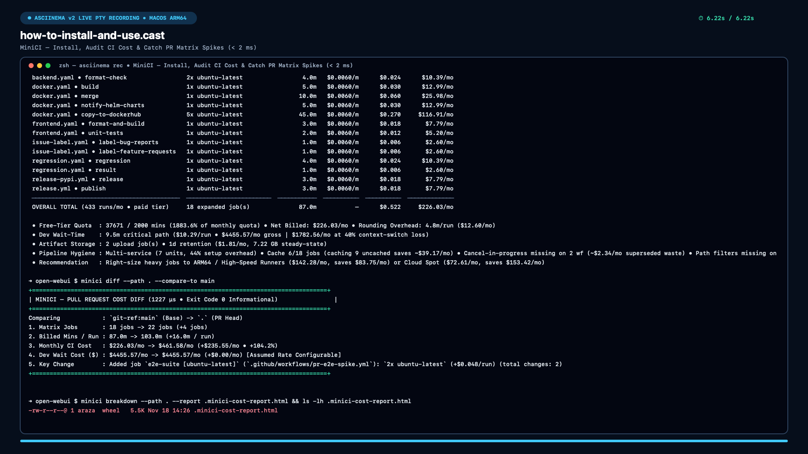

# 💰 MiniCI (`minici-cost-action`) — Sub-Millisecond CI/CD Cost Breakdown, PR Cost Diff & Quota Receipt Engine

[-orange.svg)](#)
[](#)
[](#)
[](LICENSE)

**Catch Expensive Pull Request CI Matrix Spikes Before You Merge.**

`minici` (`v0.7.0`) is a standalone, zero-dependency Pure Rust (`std` only) CLI, GitHub Action, Git `pre-push` guard, and JSON-RPC 2.0 MCP Server. In **under 2 milliseconds**, it expands your CI workflow matrices across **7 official CI/CD platforms** (`GitHub Actions`, `GitLab CI`, `CircleCI`, `Bitbucket Pipelines`, `AWS CodeBuild`, `Google Cloud Build`, and `Azure Pipelines`) plus self-hosted cloud compute (`EC2`, `GCE`, `Azure VMs`), outputting a unified receipt of **Monthly Compute Spend**, **Free-Tier Quota Burn %**, **Per-PR Cost Deltas**, and **Developer Wait-Time Cost** (`Exit 0` always).

* 🌐 **Interactive Web Calculator:** https://minici-cost-action.raza-aamir01.workers.dev
* 📖 **Step-by-Step Install & Usage Guide:** [`docs/INSTALL_AND_USAGE.md`](docs/INSTALL_AND_USAGE.md)
* 🔬 **20-Model Capabilities, Build-Time Math & Known Boundaries:** [`docs/CAPABILITIES_AND_LIMITATIONS.md`](docs/CAPABILITIES_AND_LIMITATIONS.md)
* 🔧 **Companion Auto-Patcher:** Pair with [`minici-yaml-fixer`](https://github.com/Aamir-raza-1/minici-yaml-fixer) to deterministically fix the workflow waste `minici` uncovers while preserving 100% of `#` YAML comments.

---

## 🎬 How to Install & Use (Real Customer Walkthrough)

* ▶️ **Stream Walkthrough Video in Browser (`3.1 MB`):** https://minici-cost-action.raza-aamir01.workers.dev/how-to-install-and-use.mp4 ([`web/how-to-install-and-use.mp4`](web/how-to-install-and-use.mp4))
* 📼 **Asciinema Terminal Recording (`.cast`):** [`web/how-to-install-and-use.cast`](web/how-to-install-and-use.cast) (`asciinema play web/how-to-install-and-use.cast`)
* 🎞️ **Additional Product Demo Reel:** https://minici-cost-action.raza-aamir01.workers.dev/minici-cost-demo.mp4 ([`web/minici-cost-demo.mp4`](web/minici-cost-demo.mp4))

[](https://minici-cost-action.raza-aamir01.workers.dev/how-to-install-and-use.mp4)

---

## 🏗️ Shift-Left Architecture


* **100% Standalone & Offline-Capable:** Zero external crates, zero runtime third-party CLIs, zero SaaS API keys, and zero source-code egress. All `160+` CI runner and cloud compute rates are compiled directly into the `~580 KB` Rust binary.
* **Strict Applicability Filtering:** Only prints cost lines and recommendations that genuinely apply to your repository (e.g., artifact storage appears only when `upload-artifact` jobs exist; VPC/NAT egress appears only on self-hosted cloud runners).

---

## ⚡ 30-Second Quickstart (GitHub Action)

Create `.github/workflows/minici-cost.yml` in any repository (or generate it automatically with `minici init-hooks --path .`):

```yaml
name: PR CI Cost Receipt
on:
  pull_request:
  push:
    branches: [main]

jobs:
  ci-cost-receipt:
    runs-on: ubuntu-latest
    permissions:
      contents: read
      pull-requests: write
    steps:
      - uses: actions/checkout@v4
        with:
          # Required when running `minici diff --compare-to origin/main` so Git base history is available
          fetch-depth: 0

      - name: Run MiniCI Cost Breakdown & Quota Receipt
        id: cost
        uses: Aamir-raza-1/minici-cost-action@v1
        with:
          path: "."
          compare-to: "origin/main"
          tier: "auto"
          prs-per-week: "25"
          pushes-per-pr: "4"
          dev-hourly-rate: "65"
```

### GitHub Action Inputs & Key Outputs (`action.yml`)

| Input | Default | Description |
| :--- | :---: | :--- |
| `path` | `.` | Path to repository root or workflow directory |
| `compare-to` | `""` | Optional base Git ref (e.g., `origin/main`) to also render a Pull Request cost diff table |
| `tier` | `auto` | Pricing tier mode (`auto`, `free`, or `paid`) |
| `prs-per-week` | `25` | Pull requests per week for monthly run-rate projection |
| `pushes-per-pr` | `4` | Average pushes per pull request |
| `dev-hourly-rate` | `65` | Developer hourly engineering rate (`USD`) for wait-time cost |

| Key Action Output (`steps.<id>.outputs.*`) | Description |
| :--- | :--- |
| `gross_monthly_compute_cost_usd` | Gross monthly CI/CD compute cost (`USD`) |
| `net_billed_monthly_compute_cost_usd` | Net billed monthly CI/CD compute cost after free-tier allowance (`USD`) |
| `monthly_rounding_tax_usd` | Monthly sub-minute ceiling rounding overhead (`USD`) |
| `monthly_productive_payroll_loss_usd` | Monthly developer wait-time payroll loss at `40%` context-switch factor (`USD`) |
| `arm64_migration_monthly_savings_usd` | Monthly compute savings from migrating eligible Linux `x64` jobs to `ARM64` (`USD`) |
| `recoverable_ci_and_wait_monthly_usd` | Total monthly recoverable CI compute and developer wait-time waste (`USD`) |
| `detected_stack_archetype` | Detected language/build stack archetype (`Rust`, `Node/TS`, `Python`, `Go`, `Docker`, etc.) |
| *(+ 22 additional FinOps outputs)* | Full 29-output schema documented in [`action.yml`](action.yml) |

---

## 🛠️ Local CLI Installation & Everyday Commands

### 1. Install in Under 3 Seconds (Zero External Dependencies)

```bash
# Option A: Install directly from Git with Cargo
cargo install --git https://github.com/Aamir-raza-1/minici-cost-action.git minici

# Option B: Clone & build offline (std-only Rust, compiles in ~1.5s)
git clone https://github.com/Aamir-raza-1/minici-cost-action.git
cd minici-cost-action
cargo build --release --manifest-path crates/minici/Cargo.toml
mkdir -p ~/.local/bin && cp crates/minici/target/release/minici ~/.local/bin/minici
```

### 2. Run on Any Local Repo, Branch Diff, or Public GitHub Repo

```bash
# 1. Instant executive cost & quota summary on the current repository (< 2 ms)
minici breakdown --path .

# 2. Compare your feature branch against `main` BEFORE opening a Pull Request
minici diff --path . --compare-to main

# 3. Audit ANY public GitHub repository without cloning it first (cached in ~/.minici/cache/repos/)
minici breakdown --repo open-webui/open-webui
minici breakdown --repo https://github.com/astral-sh/uv

# 4. Export standalone HTML, JSON, CSV, or GitHub PR Markdown reports
minici breakdown --path . --report ci-cost-report.html
minici breakdown --path . --report ci-cost-report.json --quiet
minici diff --path . --compare-to main --format markdown --out-file pr-comment.md

# 5. Inspect compiled 7-provider SKU catalog or install Git pre-push + MCP hooks
minici catalog
minici init-hooks --path .
```

---

## 🤖 AI Coding Agent Integration (MCP JSON-RPC 2.0 Server)

Add `minici` to `.mcp.json` (supported out of the box in Antigravity, Claude Code, Cursor, Windsurf, and VS Code):

```json
{
  "mcpServers": {
    "minici": {
      "command": "minici",
      "args": ["mcp", "--path", "."]
    }
  }
}
```

Exposed MCP tools: `minici_breakdown`, `minici_diff`, and `minici_catalog`.

---

## 🧮 How `minici` Estimates Build Duration (Static Step Heuristics + Override)

Because `minici` runs locally in `< 2 ms` with zero API tokens, it estimates per-job runtime statically from workflow YAML structure and applies each CI vendor's exact billing rounding rule:

1. **Per-Job Static Heuristic (`crates/minici/src/engine.rs`):**
   * Base runner VM boot & provisioning: `0.50m` (`3.50m` fallback when a job defines no `steps:`, excluding `0`-VM local reusable workflow caller stubs `uses: ./.github/workflows/...`).
   * `actions/checkout`: `+0.35m` (discounted by `-0.30m`, floored at `0.50m` total, when `fetch-depth: 1`, `sparse-checkout`, or blobless `--filter` is configured).
   * `upload-artifact`: `+0.35m`.
   * Test suites (`pytest`, `cargo test`, `npm test`, `vitest`, `go test`, `mvn test`): `+2.50m` per test command.
   * Heavy builds (`docker build`, `cargo build --release`): `+3.50m` per build command.
   * Each standard workflow step (`- name:`, `- run:`, `- uses:`): `+0.25m`.
2. **Provider Billing Rounding:** Applies `ceil(raw_mins)` whole-minute billing per expanded matrix job (`min 1.0m`) on GitHub Actions and Bitbucket Pipelines, and exact sub-minute billing on GitLab CI, CircleCI, and Google Cloud Build.
3. **Exact Runtime Override (`est-minutes`):** Annotate any job with `est-minutes: 18` (or `# est-minutes: 18`) in your workflow YAML to pin `minici` to your exact historical P50/P90 job duration.

---

## ⚠️ Known Boundaries & Operational Notes

For the complete engineering breakdown, see [`docs/CAPABILITIES_AND_LIMITATIONS.md`](docs/CAPABILITIES_AND_LIMITATIONS.md):

* **GitHub Action Runner Requirement:** Composite `action.yml` compiles `crates/minici` on cache miss if a prebuilt binary is not present; standard GitHub-hosted runners (`ubuntu-latest`, `macos-latest`) include `cargo` preinstalled, whereas minimal custom Docker containers (`alpine`, `node:slim`) must install Rust or mount the compiled `minici` binary.
* **Shallow Clone Pitfall on `minici diff`:** When running `minici diff --compare-to main` in CI, always pass `fetch-depth: 0` to `actions/checkout@v4` so the base Git ref exists locally.
* **Dynamic Runtime Expressions & Anchors:** Runtime JSON matrices (`strategy: matrix: ${{ fromJSON(...) }}`), YAML anchors (`<<: *defaults`), and private cross-repo reusable workflows (`uses: org/other-repo/.github/workflows/ci.yml@v1`) cannot be expanded statically without live CI execution context and default to `1x` job cardinality.
* **Zero-Clone `--repo` API Rate Limits:** Unauthenticated `minici breakdown --repo owner/repo` uses GitHub's public REST API (`60 req/hr/IP`); export `GITHUB_TOKEN` for `5,000 req/hr` or private repo access.

---

## 👤 Author & License

Built by **Aamir Raza** (`raza.aamir01@gmail.com` • GitHub: [`@Aamir-raza-1`](https://github.com/Aamir-raza-1)) • Licensed under [Apache-2.0](LICENSE).
