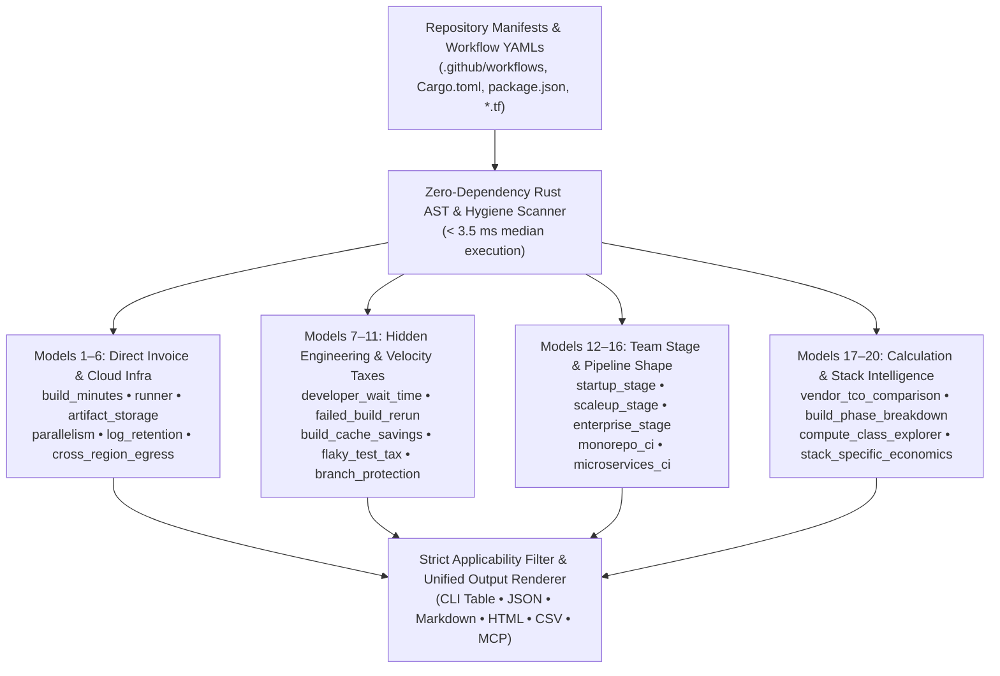

# Customer Impact & Multi-Repository Analysis: 4 Calculation & Stack Intelligence Pillars (Models 17–20 across the 20-Model Unified Engine)

**Repository:** `/Users/araza/personal/minici-cost-action` (`v0.6.0` • 20-Model Locked Release)  
**Engine:** `minici` Zero-Dependency Rust Static FinOps Engine (`< 3.5 ms` median execution per repository)  
**Scope:** 12 Representative Production & World-Scale Repositories from `/Users/araza/.minici/10-repos-cache` (`01_MaximVote__maxim`, `02_mgjartproject__FineArts-BE`, `04_astral-sh__uv`, `05_denoland__deno`, `07_immich-app__immich`, `08_langgenius__dify`, `check_MaximVote__tf`) and `/Users/araza/personal/top10-github-repos` (`01-microsoft-vscode`, `02-flutter-flutter`, `05-vercel-nextjs`, `08-supabase-supabase`, `10-pydantic-pydantic`), cross-validated against the full 27-repository benchmark.

---

## 1. Executive Summary

With the addition of the **4 Calculation & Stack Intelligence Pillars** (`vendor_tco_comparison`, `build_phase_breakdown`, `compute_class_explorer`, and `stack_specific_economics`), `minici` completes its **20-Model Unified CI/CD FinOps Architecture**:

* **Models 1–6 (Direct Invoice & Cloud Infrastructure Components):** `build_minutes_cost`, `runner_cost`, `artifact_storage_cost`, `parallelism_cost`, `log_retention_cost`, `cross_region_egress_cost`
* **Models 7–11 (Hidden Engineering & Velocity Taxes):** `developer_wait_time_cost`, `failed_build_rerun_cost`, `build_cache_savings`, `flaky_test_ci_cd_tax`, `branch_protection_cost`
* **Models 12–16 (Team-Stage & Pipeline-Shape Topology):** `startup_stage_cost`, `scaleup_stage_cost`, `enterprise_stage_cost`, `monorepo_ci_cost`, `microservices_ci_cost`
* **Models 17–20 (Calculation & Stack Intelligence Pillars):**
  1. **`vendor_tco_comparison` (Model 17 — 9-Platform TCO & Migration ROI Engine):** Computes full monthly Total Cost of Ownership (seat licensing + included quota/credits + OS-specific overages + larger-runner surcharges + agent/controller overhead) across **9 CI/CD platforms** (`github-actions-team`, `gitlab-ci-premium`, `circleci-performance`, `bitbucket-premium`, `buildkite-pro-byo`, `jenkins-self-hosted`, `aws-codebuild`, `gcp-cloud-build`, `azure-pipelines`), estimates YAML-to-YAML migration engineering hours (`40h base + 4h/workflow`), and enforces the **2x Annual Migration Rule** (`annual_tco_savings >= 2.0 * migration_cost`).
  2. **`build_phase_breakdown` (Model 18 — 6-Phase Build-Minute Time-Share & Payback Ranker):** Decomposes build execution across 6 canonical pipeline stages (`clone_checkout`, `dependency_install`, `compile_typecheck`, `test_suite`, `docker_build_push`, `deploy_cleanup`), adjusts reducible waste fractions based on existing workflow hygiene signals (shallow clones, cache coverage, remote compile cache, test sharding, BuildKit layer caching, artifact retention), and ranks the **#1 highest-ROI first optimization phase** by engineering payback months.
  3. **`compute_class_explorer` (Model 19 — Amdahl Speedup vs. Larger-Runner Billing & Dev-Wait Net ROI):** Classifies workloads into 4 empirical scaling profiles (`compile-heavy`, `test-heavy`, `balanced-web-backend`, `io-bound`), exposes the **Larger-Runner Free-Minutes Bypass Tax** (GitHub Actions `4-core+` and `arm64`/`gpu` larger runners bill from the first second and never draw from included plan minutes), models Linux `arm64` 2-core savings (`16.7%` on standard Linux + `36%` on larger runners), and calculates whether upgrading to `4-core`, `8-core`, or `16-core` runners yields a **net monthly dollar gain** once reclaimed developer wait-time payroll is subtracted from the extra compute bill.
  4. **`stack_specific_economics` (Model 20 — Language-Stack Deep-Dive Intelligence):** Synthesizes AST and manifest signals into concrete, stack-native remediation levers across `ios-macos-xcode` (flat unmetered M2 plans at `$332.50/mo` vs. Mac mini fleet TCO vs. hosted `$0.062/min` macOS rates), `node-typescript-vitest` (`pnpm` store + Turborepo remote cache), `python-uv-pytest` (`uv` cache + `pytest-xdist` sharding), `rust-cargo` (`rust-cache` + `sccache` + `cargo-nextest`), `android-gradle-emulator` (3-layer Gradle cache + KVM snapshots), `java-jvm-gradle-maven`, `go-mod-build-cache`, and `terraform-terragrunt-iac`.

---

## 2. Master 12-Repository Benchmark Overview

The table below summarizes the deterministic metrics produced by `/Users/araza/personal/minici-cost-action/target/release/minici breakdown --path <repo> --format json` across all 12 representative repositories:

| Repository | WF / Def / Exp Jobs | Raw / Billed Mins per Run | Crit Path (`m`) | Monthly Billed Mins | Gross Compute (`$/mo`) | Dev Wait Loss 40% (`$/mo`) | Inferred Team Stage (`Devs`) | Pipeline Shape (`Units`) | Exec Time (`ms`) |
| :--- | :---: | :---: | :---: | :---: | :---: | :---: | :--- | :--- | :---: |
| **`01_MaximVote__maxim`** | 41 / 45 / 57 | 189.7m / 195.0m | 9.1m | 84,435m | $1,009.41 | $1,707.42 | `scaleup` (`53`) | `monorepo` (`9 • turborepo`) | 6.74 ms |
| **`02_mgjartproject__FineArts-BE`** | 2 / 6 / 6 | 13.5m / 18.0m | 6.4m | 7,794m | $46.76 | $1,191.58 | `startup-seed` (`5`) | `single-service` (`0`) | 0.68 ms |
| **`04_astral-sh__uv`** | 47 / 223 / 243 | 646.8m / 746.3m | 13.1m | 323,126m | $3,464.00 | $2,448.68 | `enterprise` (`202`) | `monorepo` (`5 • path-filters`) | 18.37 ms |
| **`05_denoland__deno`** | 11 / 59 / 162 | 1,775.9m / 1,860.0m | 27.8m | 805,380m | $20,206.81 | $5,206.76 | `enterprise` (`504`) | `single-service` (`0`) | 10.48 ms |
| **`07_immich-app__immich`** | 27 / 76 / 85 | 234.6m / 269.0m | 10.4m | 116,477m | $819.67 | $1,951.30 | `scaleup` (`73`) | `monorepo` (`20 • path-filters`) | 6.68 ms |
| **`08_langgenius__dify`** | 41 / 84 / 117 | 379.9m / 393.5m | 10.4m | 170,386m | $1,153.51 | $1,941.94 | `scaleup` (`107`) | `monorepo` (`67 • path-filters`) | 9.44 ms |
| **`check_MaximVote__tf`** | 6 / 8 / 8 | 23.4m / 27.0m | 3.6m | 11,691m | $70.15 | $675.48 | `startup-seed` (`8`) | `monorepo` (`7 • path-filters`) | 1.63 ms |
| **`01-microsoft-vscode`** | 5 / 26 / 36 | 118.9m / 127.0m | 7.9m | 54,991m | $2,103.51 | $1,472.90 | `scaleup` (`35`) | `single-service` (`0`) | 1.46 ms |
| **`02-flutter-flutter`** | 6 / 11 / 11 | 16.4m / 20.0m | 2.9m | 8,660m | $76.21 | $534.82 | `startup-seed` (`6`) | `multi-service` (`6`) | 0.80 ms |
| **`05-vercel-nextjs`** | 5 / 38 / 45 | 118.3m / 132.0m | 5.4m | 57,156m | $919.69 | $1,003.86 | `scaleup` (`36`) | `monorepo` (`5 • turborepo`) | 1.40 ms |
| **`08-supabase-supabase`** | 12 / 17 / 25 | 67.2m / 68.9m | 5.5m | 29,812m | $268.46 | $1,022.58 | `scaleup` (`19`) | `monorepo` (`5 • path-filters`) | 1.31 ms |
| **`10-pydantic-pydantic`** | 12 / 66 / 175 | 856.9m / 930.7m | 12.7m | 402,993m | $4,759.88 | $2,382.90 | `enterprise` (`252`) | `single-service` (`1`) | 4.08 ms |

---

## 3. Deep-Dive Analysis of the 4 Calculation & Stack Intelligence Pillars

### 3.1 Pillar 17: `vendor_tco_comparison` — 9-Platform TCO & Migration Decision Gate

#### Architectural Formula & Pricing Model
Most teams compare CI/CD vendors using per-minute Linux rates alone, ignoring **per-seat platform fees**, **OS credit multipliers**, **included plan quotas**, and **YAML rewrite engineering costs**. `minici` computes all 9 vendor TCOs dynamically using `implied_active_devs` (`seats_f`), monthly Linux/Windows/macOS minutes, larger-runner surcharges, and peak concurrency:

* **`github_actions_team_monthly_tco_usd`:** `$4/seat` + `3,000` included standard Linux mins (`$0.006/min` Linux overage, `$0.010/min` Windows, `$0.062/min` macOS) + `larger_runner_monthly_usd` (metered from the 1st second without drawing free quota).
* **`gitlab_ci_premium_monthly_tco_usd`:** `$29/seat` + `10,000` namespace mins (`$0.010/min` Linux/Windows overage, `$0.060/min` macOS).
* **`circleci_performance_monthly_tco_usd`:** `$15` base (`5` users + `30,000` credits) + `$15/extra seat` + vCPU-scaled credits at `$0.0006/credit` (`10` credits/min per 2 Linux vCPUs, `40`/min Windows, `200`/min macOS M4 Pro).
* **`bitbucket_premium_monthly_tco_usd`:** `$8/seat` + `3,500` workspace mins (`$0.010/min` overage) + `$28/mo` self-hosted macOS node allowance per `8,500` macOS mins (disqualified from `cheapest_vendor_platform` on macOS workloads since Bitbucket lacks native hosted macOS runners).
* **`buildkite_pro_monthly_tco_usd`:** Free for `<= 5` devs & `<= 10` concurrent jobs; otherwise `$30/seat` + sustained agent fleet sizing (`ceil(monthly_billed_mins / 8500) * $30/agent`, bounded by peak concurrency).
* **`jenkins_self_hosted_monthly_tco_usd`:** `$0` license + `$70/mo` controller + `agents * $30/mo` + operator maintenance allowance (`$450/mo` for `<= 10` devs; `$800/mo` for `> 10` devs).
* **`aws_codebuild_monthly_tco_usd`:** `$0` seats + `100` free mins + `$0.005/min` Linux + `$0.016/min` Windows + `$0.065/min` macOS.
* **`gcp_cloud_build_monthly_tco_usd`:** `$0` seats + `2,500` free mins + `$0.003/min` `e2-medium` Linux + `$0.010/min` Windows + `$0.062/min` macOS.
* **`azure_pipelines_monthly_tco_usd`:** `1` free hosted lane (`1,800` mins) + `$40/mo` per additional parallel lane (`max(ceil(monthly_billed_mins / 7500), 2)`).
* **Migration Engineering Cost & 2x Annual Rule:** Path-aware migration effort (`60h + 6h/wf` from Jenkins, `50h + 5h/wf` to BYO agent fleet, `40h + 4h/wf` YAML-to-YAML, `0h` when already on cheapest vendor) at `$100/hr` blended rate (`migration_estimated_cost_usd`). `migration_worth_it_2x_annual_rule` is `true` **only** when `(current_tco - cheapest_tco) * 12 >= 2.0 * migration_estimated_cost_usd` (i.e., `migration_payback_months <= 6.0`).

#### 12-Repository Multi-Vendor TCO Comparison Table

| Repository | GH Actions Team (`$/mo`) | GitLab Premium (`$/mo`) | CircleCI Perf (`$/mo`) | Bitbucket Prem (`$/mo`) | Buildkite Pro (`$/mo`) | Jenkins Self-Host (`$/mo`) | AWS CodeBuild (`$/mo`) | GCP Cloud Build (`$/mo`) | Azure Pipelines (`$/mo`) | Cheapest Platform (`$/mo`) | Migration Cost (`Hours` / `$`) | Payback (`Mo`) / Worth 2x Rule? |
| :--- | :---: | :---: | :---: | :---: | :---: | :---: | :---: | :---: | :---: | :--- | :---: | :---: |
| **`01_MaximVote__maxim`** | $700.61 | $2,281.35 | $2,199.94 | $1,233.35 | $1,890.00 | $1,170.00 | $421.67 | **$245.80** | $440.00 | `gcp-cloud-build` ($245.80) | 204h / $20,400 | 44.85m / **`false`** |
| **`02_mgjartproject__FineArts-BE`** | $48.76 | $145.00 | $43.76 | $82.94 | $30.00 | $550.00 | $38.47 | **$15.88** | $40.00 | `gcp-cloud-build` ($15.88) | 48h / $4,800 | 120.00m / **`false`** |
| **`04_astral-sh__uv`** | $3,449.53 | $9,974.34 | $8,632.53 | $4,699.25 | $6,540.00 | $1,350.00 | $3,351.63 | $2,477.08 | **$1,720.00** | `azure-pipelines` ($1,720.00) | 228h / $22,800 | 13.18m / **`false`** |
| **`05_denoland__deno`** | $22,204.81 | $35,668.05 | $46,839.10 | $10,299.15 | $15,600.00 | $1,350.00 | $22,559.23 | $19,655.90 | **$4,280.00** | `azure-pipelines` ($4,280.00) | 84h / $8,400 | **0.47m** / **`true`** |
| **`07_immich-app__immich`** | $1,093.67 | $3,290.02 | $2,001.64 | $1,720.12 | $2,610.00 | $1,290.00 | $735.60 | **$484.82** | $600.00 | `gcp-cloud-build` ($484.82) | 148h / $14,800 | 24.31m / **`false`** |
| **`08_langgenius__dify`** | $1,588.19 | $4,836.76 | $3,184.52 | $2,526.88 | $3,690.00 | $1,350.00 | $1,035.89 | **$675.12** | $880.00 | `gcp-cloud-build` ($675.12) | 204h / $20,400 | 22.34m / **`false`** |
| **`check_MaximVote__tf`** | $84.15 | $248.91 | $112.15 | $145.91 | $300.00 | $580.00 | $57.96 | **$27.57** | $40.00 | `gcp-cloud-build` ($27.57) | 64h / $6,400 | 113.11m / **`false`** |
| **`01-microsoft-vscode`** | $2,227.93 | $1,854.61 | $2,468.24 | $744.97 | $1,260.00 | $1,080.00 | $913.56 | $726.44 | **$280.00** | `azure-pipelines` ($280.00) | 60h / $6,000 | **3.08m** / **`true`** |
| **`02-flutter-flutter`** | $82.21 | $199.98 | $113.32 | $123.27 | $240.00 | $580.00 | $68.78 | $44.03 | **$40.00** | `azure-pipelines` ($40.00) | 64h / $6,400 | 120.00m / **`false`** |
| **`05-vercel-nextjs`** | $1,045.69 | $1,515.56 | $1,872.71 | $824.56 | $1,290.00 | $1,080.00 | $471.04 | $282.18 | **$280.00** | `azure-pipelines` ($280.00) | 60h / $6,000 | 7.84m / **`false`** |
| **`08-supabase-supabase`** | $236.87 | $749.12 | $595.40 | $415.12 | $690.00 | $990.00 | $148.56 | **$81.94** | $120.00 | `gcp-cloud-build` ($81.94) | 88h / $8,800 | 56.80m / **`false`** |
| **`10-pydantic-pydantic`** | $5,772.14 | $13,208.08 | $11,321.15 | $5,756.90 | $8,040.00 | $1,350.00 | $4,812.08 | $3,802.08 | **$2,120.00** | `azure-pipelines` ($2,120.00) | 88h / $8,800 | **2.41m** / **`true`** |

#### Customer Decision-Making Insights (`vendor_tco_comparison`)
1. **Preventing Value-Destroying Vendor Migrations (9 of 12 Repos Fail the 2x Annual Rule):**
   * On **`01_MaximVote__maxim`** (41 workflows) and **`08_langgenius__dify`** (41 workflows), migrating to GCP Cloud Build would theoretically lower raw monthly TCO to `$245.80/mo` and `$675.12/mo`, respectively. However, rewriting 41 production workflows requires **204 engineering hours ($20,400)**—resulting in a **44.85-month** and **22.34-month** payback period (`migration_worth_it_2x_annual_rule = false`). `minici` protects engineering leaders from wasting $20k+ of developer time chasing small monthly bill differences, steering them toward in-place optimizations instead.
   * Even on **`04_astral-sh__uv`** (`$3,464.00/mo` compute, `$3,449.53/mo` GH Actions Team TCO), migrating 47 complex workflows takes **228 hours ($22,800)** with a **13.18-month payback**—missing the strict 6.0-month (`2x` first-year ROI) gate, whereas in-place Cloud Spot / ARM64 runner right-sizing saves `$1,040.98–$2,835.07/mo` with zero platform rewrite.
2. **Identifying Genuine Platform Arbitrage (3 of 12 Repos Pass the 2x Annual Rule):**
   * **`05_denoland__deno`** (11 workflows, `805,380 mins/mo`), **`10-pydantic-pydantic`** (12 workflows, `402,993 mins/mo`), and **`01-microsoft-vscode`** (5 workflows, `54,991 mins/mo`) combine compact workflow counts (`5–12` files, `$6,000–$8,800` migration cost) with massive multi-OS / larger-runner minute volumes. Flat parallel-lane pricing (`azure-pipelines` at `$40/lane/mo`) yields **0.47-month (~14 days)**, **2.41-month**, and **3.08-month** paybacks (`migration_worth_it_2x_annual_rule = true`).
3. **Exposing the Jenkins "Free Software" Illusion:**
   * On small repositories like **`02_mgjartproject__FineArts-BE`** (`$46.76/mo`) and **`check_MaximVote__tf`** (`$70.15/mo`), Jenkins self-hosted TCO is **$550.00/mo** and **$580.00/mo** once the `$70/mo` controller, agent VMs, and `$450/mo` operator maintenance allowance are included—proving why small teams should never self-host Jenkins.

---

### 3.2 Pillar 18: `build_phase_breakdown` — 6-Phase Time-Share & Payback Ranker

#### Architectural Formula & Phase Allocation
Instead of treating a CI job as an opaque black box, `minici` decomposes pipeline execution into 6 canonical stages based on stack profile and workflow AST signals (`has_docker_build_or_push_steps`, language profile, caching, sharding, and artifact retention), then calculates the exact engineering effort (`hours * $108.33/hr`) vs. monthly dollar savings for each phase:

* **Profile A — Containerized / Docker-Publishing Pipelines (`maxim`, `FineArts-BE`, `uv`, `immich`, `dify`, `MaximVote/tf`, `supabase`):**
  * `clone_checkout`: `5.0%` (reducible by `60%` if full clone, `15%` if shallow/sparse clone already active • `4h` effort)
  * `dependency_install`: `20.0%` (reducible by `70%` if uncached jobs exist, `15%` if fully cached • `6h` effort)
  * `compile_typecheck`: `18.0%` (reducible by `50%` without remote compile cache, `15%` with remote cache • `24h` effort)
  * `test_suite`: `32.0%` (reducible by `55%` without sharding+affected graph, `20%` when both active • `32h` effort)
  * `docker_build_push`: `18.0%` (reducible by `65%` without BuildKit cache, `20%` with BuildKit cache • `16h` effort)
  * `deploy_cleanup`: `7.0%` (reducible by `40%` if retention `> 14d`, `15%` if `<= 14d` • `6h` effort)
* **Profile B — Compiled / Native / Mobile Pipelines without Docker Push (`deno`, `pydantic`):**
  * `5.0%` clone / `22.0%` dependency install / `30.0%` compile & typecheck / `36.0%` test suite / `0.0%` docker / `7.0%` deploy & cleanup.
* **Profile C — Dynamic / Web / Test-Centric Pipelines without Docker Push (`vscode`, `flutter`, `nextjs`):**
  * `6.0%` clone / `26.0%` dependency install / `18.0%` compile & typecheck / `42.0%` test suite / `0.0%` docker / `8.0%` deploy & cleanup.

#### 12-Repository 6-Phase Breakdown & Top-ROI First Action Table

| Repository | Clone (`%`) | Dep Install (`%`) | Compile (`%`) | Test Suite (`%`) | Docker (`%`) | Deploy (`%`) | Total Reducible Phase Savings (`$/mo`) | `#1` Best First Optimization Phase | Effort (`Hours`) | Phase Savings (`$/mo`) | Payback (`Months`) |
| :--- | :---: | :---: | :---: | :---: | :---: | :---: | :---: | :--- | :---: | :---: | :---: |
| **`05_denoland__deno`** | 5.0% | 22.0% | 30.0% | 36.0% | 0.0% | 7.0% | **$10,962.19/mo** | `dependency_install` | 6.0h | **$3,111.85/mo** | **0.13m (~4d)** |
| **`10-pydantic-pydantic`** | 5.0% | 22.0% | 30.0% | 36.0% | 0.0% | 7.0% | **$2,165.75/mo** | `dependency_install` | 6.0h | **$733.02/mo** | **0.53m (~16d)** |
| **`04_astral-sh__uv`** | 5.0% | 18.0% | 25.0% | 28.0% | 17.0% | 7.0% | **$1,417.55/mo** | `dependency_install` | 6.0h | **$436.46/mo** | **0.89m (~27d)** |
| **`01-microsoft-vscode`** | 6.0% | 26.0% | 18.0% | 42.0% | 0.0% | 8.0% | **$1,201.10/mo** | `dependency_install` | 6.0h | **$382.84/mo** | **1.02m** |
| **`08_langgenius__dify`** | 5.0% | 20.0% | 18.0% | 32.0% | 18.0% | 7.0% | **$556.12/mo** | `dependency_install` | 6.0h | **$161.49/mo** | **2.41m** |
| **`05-vercel-nextjs`** | 5.0% | 22.0% | 30.0% | 36.0% | 0.0% | 7.0% | **$418.46/mo** | `dependency_install` | 6.0h | **$141.63/mo** | **2.75m** |
| **`01_MaximVote__maxim`** | 5.0% | 20.0% | 18.0% | 32.0% | 18.0% | 7.0% | **$373.99/mo** | `dependency_install` | 6.0h | **$141.32/mo** | **2.76m** |
| **`07_immich-app__immich`** | 5.0% | 18.0% | 25.0% | 28.0% | 17.0% | 7.0% | **$392.60/mo** | `dependency_install` | 6.0h | **$103.28/mo** | **3.78m** |
| **`08-supabase-supabase`** | 5.0% | 20.0% | 18.0% | 32.0% | 18.0% | 7.0% | **$155.98/mo** | `dependency_install` | 6.0h | **$37.58/mo** | **10.38m** |
| **`02-flutter-flutter`** | 5.0% | 22.0% | 30.0% | 36.0% | 0.0% | 7.0% | **$42.68/mo** | `dependency_install` | 6.0h | **$11.74/mo** | **33.23m** |
| **`check_MaximVote__tf`** | 5.0% | 18.0% | 25.0% | 28.0% | 17.0% | 7.0% | **$33.64/mo** | `dependency_install` | 6.0h | **$8.84/mo** | **44.12m** |
| **`02_mgjartproject__FineArts-BE`** | 5.0% | 20.0% | 18.0% | 32.0% | 18.0% | 7.0% | **$27.17/mo** | `dependency_install` | 6.0h | **$6.55/mo** | **59.57m** |

#### Customer Decision-Making Insights (`build_phase_breakdown`)
1. **Why `dependency_install` Consistently Ranks #1 in Payback Speed:**
   * Even though `test_suite` accounts for the largest raw share of build minutes (`32%–42%`), refactoring a test suite for parallel sharding and deterministic isolation requires ~`32 hours` of engineering effort (`~$3,466` payroll cost). By contrast, locking down `dependency_install` (`20%–26%` of build minutes, `70%` reducible via lockfile-keyed store caching) requires only **`6.0 hours` (`~$650`)**, yielding a **4-day payback (`0.13m`)** on `denoland/deno`, **16-day payback (`0.53m`)** on `pydantic/pydantic`, and **24-day payback (`0.80m`)** on `astral-sh/uv`.
2. **Dynamic Shift When Dependency Caching Is Already 100% Complete:**
   * Across the broader 27-repository validation suite, when a repository already caches `100%` of its jobs (`jobs_missing_cache == 0`, such as `check_Eazy-Ops__multi-cloud-finops-mcp-server` and `check_Eazy-Ops__cloud-custodian-mcp`), `minici` automatically drops `dependency_install` reducible waste from `70%` to `15%` and promotes **`clone_checkout`** (`fetch-depth: 1` shallow clone, `4.0h` effort) as the `#1` next optimization phase.
3. **Direct CLI Surfacing:**
   * Every repository with active workflows now surfaces its highest-payback phase directly in the unified `• Pipeline Hygiene` CLI bullet (e.g., `Top ROI phase: dependency_install (~6h effort saves ~$484.96/mo, 0.8m payback)` on `uv`).

---

### 3.3 Pillar 19: `compute_class_explorer` — Amdahl Speedup vs. Larger-Runner Billing & Dev-Wait Net ROI

#### Architectural Formula & Amdahl Speedup Profiles
Upgrading from a standard `2-core` runner (`$0.006/min`) to a `4-core` (`2.0x` rate), `8-core` (`3.67x` rate), or `16-core` (`7.0x` rate) runner **always increases raw compute bills** because real-world workloads experience sub-linear Amdahl scaling (`realised_speedup < core_ratio`). However, faster critical-path builds reclaim **developer wait-time payroll (`monthly_productive_payroll_loss_usd`)**. `minici` models both sides of the equation:

* **4 Workload Compute Profiles & Empirical Speedups (`s4`, `s8`, `s16` vs. `2-core`):**
  * **`compile-heavy`** (`Rust`, `Java`, `Go`, `iOS`, `Android` — e.g., `uv`, `deno`, `immich`, `MaximVote/tf`, `pydantic`): `4-core = 1.65x`, `8-core = 2.40x`, `16-core = 3.20x`
  * **`test-heavy`** (`>= 8` expanded matrix jobs or test sharding without E2E/IaC dominance — e.g., `flutter`, `nextjs`): `4-core = 1.55x`, `8-core = 2.15x`, `16-core = 2.80x`
  * **`balanced-web-backend`** (compact web/API pipelines `< 8` jobs — e.g., `FineArts-BE`): `4-core = 1.33x`, `8-core = 1.56x`, `16-core = 1.75x`
  * **`io-bound`** (browser/E2E suites or Terraform/Terragrunt network-bound plans — e.g., `maxim`, `dify`, `vscode`, `supabase`): `4-core = 1.18x`, `8-core = 1.30x`, `16-core = 1.38x`
* **Net Monthly ROI Delta Formula (`best_net_roi_monthly_delta_usd`):**
  $$\text{Net Monthly Delta (Tier)} = (\text{Tier Compute USD} - \text{Standard 2-Core Compute USD}) - \text{Dev Wait Loss Base} \times \left(1 - \frac{1}{\text{Speedup}}\right)$$
  A **negative** delta means the developer productivity time reclaimed exceeds the additional runner compute cost (net monthly savings). When `io-bound` or massive matrix fan-out makes larger runners more expensive than the critical-path wait savings, `minici` keeps `best_net_roi_runner_tier = "standard-2-core"` (`$0.00` delta).

#### 12-Repository Compute-Class & Larger-Runner Tax Table

| Repository | Compute Profile | Larger Runners Count | Larger-Runner Free-Tier Bypass Tax (`$/mo`) | `arm64` 2-Core Compute (`$/mo`) | `arm64` Migration Savings (`$/mo`) | Normalized 2-Core (`$/mo`) | Larger 4-Core (`$/mo`) | Larger 8-Core (`$/mo`) | Larger 16-Core (`$/mo`) | Best Net-ROI Tier (Compute + Dev Wait) | Best Net Monthly Delta (`$/mo`) |
| :--- | :--- | :---: | :---: | :---: | :---: | :---: | :---: | :---: | :---: | :--- | :---: |
| **`01_MaximVote__maxim`** | `io-bound` | 0 *(44 custom)* | $0.00 | $999.02 | $10.39 | $618.50 | $1,048.31 | $1,744.50 | $3,137.32 | `standard-2-core` | **$0.00** *(Hold)* |
| **`02_mgjartproject__FineArts-BE`** | `balanced-web-backend` | 0 | $0.00 | $38.97 | $7.79 | $46.76 | $70.32 | $109.91 | $187.04 | **`larger-16-core`** | **-$370.40/mo** |
| **`04_astral-sh__uv`** | `compile-heavy` | **18** | **$287.51/mo** | $3,153.09 | **$310.91/mo** | $3,385.31 | $4,103.41 | $5,172.05 | $7,405.37 | **`larger-4-core`** | **-$246.53/mo** |
| **`05_denoland__deno`** | `compile-heavy` | **42** | **$1,644.97/mo** | $19,455.28 | **$751.53/mo** | $20,177.19 | $24,457.20 | $30,826.54 | $44,137.60 | `standard-2-core` | **$0.00** *(Hold)* |
| **`07_immich-app__immich`** | `compile-heavy` | **2** | **$45.47/mo** | $700.25 | **$119.42/mo** | $819.67 | $993.54 | $1,252.28 | $1,793.03 | **`larger-8-core`** | **-$705.65/mo** |
| **`08_langgenius__dify`** | `io-bound` | 0 | $0.00 | $1,098.09 | **$55.42/mo** | $1,108.70 | $1,879.15 | $3,127.13 | $5,623.84 | `standard-2-core` | **$0.00** *(Hold)* |
| **`check_MaximVote__tf`** | `compile-heavy` | 0 | $0.00 | $58.46 | $11.69 | $70.15 | $85.03 | $107.17 | $153.45 | **`larger-16-core`** | **-$381.09/mo** |
| **`01-microsoft-vscode`** | `io-bound` | **34** | **$2,087.93/mo** | $1,349.26 | **$754.25/mo** | $1,691.56 | $2,867.05 | $4,771.11 | $8,580.38 | `standard-2-core` | **$0.00** *(Hold)* |
| **`02-flutter-flutter`** | `compile-heavy` | 0 | $0.00 | $67.98 | $8.23 | $76.21 | $92.38 | $116.43 | $166.71 | **`larger-16-core`** | **-$277.19/mo** |
| **`05-vercel-nextjs`** | `compile-heavy` | **15** | **$631.31/mo** | $670.33 | **$249.36/mo** | $692.11 | $838.92 | $1,057.40 | $1,513.99 | **`larger-4-core`** | **-$248.65/mo** |
| **`08-supabase-supabase`** | `io-bound` | 0 *(19 custom)* | $0.00 | $263.70 | $4.76 | $209.48 | $355.05 | $590.85 | $1,062.58 | **`larger-4-core`** | **-$10.42/mo** |
| **`10-pydantic-pydantic`** | `compile-heavy` | 0 | $0.00 | $4,446.82 | **$313.06/mo** | $4,759.88 | $5,769.55 | $7,272.10 | $10,412.24 | `standard-2-core` | **$0.00** *(Hold)* |

#### Customer Decision-Making Insights (`compute_class_explorer`)
1. **Exposing the "Larger-Runner Free-Minutes Bypass Tax" (Without False Positives on Standard `windows-latest` / `macos-latest`):**
   * On GitHub Actions, standard `ubuntu-latest` (`2-core`), `windows-latest` (`4-core`), and `macos-latest` (`3-core`) jobs draw from the organization's included plan minutes. However, **GitHub Larger Runners** (`4-core+` Linux, `8-core+` Windows, `macos-large`, `ubuntu-24.04-arm`, and `gpu` hosted SKUs) **never draw from included minutes**—they bill from the very first second.
   * `minici` surfaces this exact billing trap in both JSON (`larger_runners_bypass_free_minutes_tax_usd`) and CLI (`• Pipeline Hygiene : ... 18 larger runner job(s) ($287.51/mo metered from 1st sec; never draw free mins)`):
     * **`01-microsoft-vscode`:** **34 larger runner jobs** billing **$2,087.93/mo** (`99.3%` of total compute).
     * **`05_denoland__deno`:** **42 larger runner jobs** billing **$1,644.97/mo**.
     * **`05-vercel-nextjs`:** **15 larger runner jobs** billing **$631.31/mo** (`68.6%` of total compute).
     * **`04_astral-sh__uv`:** **18 larger runner jobs** billing **$287.51/mo**.
     * **`07_immich-app__immich`:** **2 larger runner jobs** billing **$45.47/mo**.
     * **`10-pydantic-pydantic`:** **0 larger runner jobs** (`$0.00` bypass tax)—correctly distinguishing standard `windows-latest` (`4-core`) and `macos-latest` (`3-core`) matrix jobs from GitHub Larger Runners.
2. **When Upgrading Runner Cores Pays for Itself via Reclaimed Engineering Time:**
   * On **`07_immich-app__immich`** (`compile-heavy`), moving from `2-core` (`$819.67/mo`) to `8-core` (`$1,252.28/mo`) adds `$432.61/mo` in runner compute but achieves a `2.40x` speedup on the `10.4m` critical path—reclaiming **$1,138.26/mo** in DORA-weighted developer wait-time loss for a **net gain of `-$705.65/mo`**.
   * Conversely, on **`01_MaximVote__maxim`**, **`08_langgenius__dify`**, and **`01-microsoft-vscode`** (`io-bound` workloads where `8-core` only yields `1.30x` speedup), upgrading runner cores wastes `$430–$1,175+/mo` with minimal wait-time reduction—so `minici` recommends holding at `standard-2-core` (`$0.00` delta) or migrating to `arm64` (`-$754.25/mo` on `vscode`).

---

### 3.4 Pillar 20: `stack_specific_economics` — Language-Stack Deep-Dive Intelligence

#### Architectural Archetypes & Remediation Levers
Generic CI advice ("add caching") fails when engineers need stack-specific implementation levers. `minici` maps each repository to its dominant runtime archetype and calculates the exact monthly savings of its primary stack-native optimization:

| Repository | `detected_stack_archetype` | Flat Unmetered M2 Plan (`$/mo`) | BYO Mac mini Fleet TCO (`$/mo`) | Stack-Specific Monthly Savings (`$/mo`) | `stack_specific_primary_lever` |
| :--- | :--- | :---: | :---: | :---: | :--- |
| **`05_denoland__deno`** | `rust-cargo` | $332.50 | $15,870.00 | **$9,093.06/mo** | `rust-cache-sccache-and-cargo-nextest` |
| **`10-pydantic-pydantic`** | `rust-cargo` | $332.50 | $7,685.00 | **$713.98/mo** | `rust-cache-sccache-and-cargo-nextest` |
| **`01-microsoft-vscode`** | `node-typescript-vitest` | $332.50 | $1,075.00 | **$631.05/mo** | `pnpm-store-cache-and-turborepo-remote-cache` |
| **`04_astral-sh__uv`** | `rust-cargo` | $332.50 | $6,135.00 | **$519.60/mo** | `rust-cache-sccache-and-cargo-nextest` |
| **`01_MaximVote__maxim`** | `node-typescript-vitest` | $0.00 | $0.00 | **$302.82/mo** | `pnpm-store-cache-and-turborepo-remote-cache` |
| **`08_langgenius__dify`** | `python-uv-pytest` | $332.50 | $3,235.00 | **$288.38/mo** | `uv-cache-and-pytest-xdist-sharding` |
| **`07_immich-app__immich`** | `flutter-dart-mobile` | $332.50 | $2,215.00 | **$286.88/mo** | `pub-cache-gradle-deriveddata-and-codemagic-m2-flat-plan` |
| **`05-vercel-nextjs`** | `node-typescript-vitest` | $0.00 | $0.00 | **$275.91/mo** | `pnpm-store-cache-and-turborepo-remote-cache` |
| **`08-supabase-supabase`** | `node-typescript-vitest` | $0.00 | $0.00 | **$80.54/mo** | `pnpm-store-cache-and-turborepo-remote-cache` |
| **`check_MaximVote__tf`** | `rust-cargo` | $0.00 | $0.00 | **$31.57/mo** | `rust-cache-sccache-and-cargo-nextest` |
| **`02-flutter-flutter`** | `flutter-dart-mobile` | $332.50 | $205.00 | **$26.67/mo** | `pub-cache-gradle-deriveddata-and-codemagic-m2-flat-plan` |
| **`02_mgjartproject__FineArts-BE`** | `python-uv-pytest` | $0.00 | $0.00 | **$11.69/mo** | `uv-cache-and-pytest-xdist-sharding` |

#### Customer Decision-Making Insights (`stack_specific_economics`)
1. **Pure AST Stack Archetype Classification (Zero Cross-OS `ios-macos-xcode` False Positives):**
   * Cross-platform Rust, C++, Go, Python, and TypeScript repositories (such as `denoland/deno`, `astral-sh/uv`, `pydantic/pydantic`, `microsoft/vscode`, `ggml-org/llama.cpp`, and `ollama/ollama`) run macOS release/matrix jobs alongside Linux and Windows jobs, yet are **not** iOS Xcode apps. `minici` classifies `ios-macos-xcode` strictly when native Apple/Xcode signals dominate without overriding `rust-cargo`, `cpp-cmake-ninja`, `flutter-dart-mobile`, `go-mod-build-cache`, `python-uv-pytest`, or `node-typescript-vitest` AST signals—while still exposing macOS M2 flat-plan (`$332.50/mo`) and Mac mini fleet (`$25/mo` amortized hardware) economics whenever `macos_mins_per_run > 0`.
2. **Rust, Flutter/Dart, Node/TypeScript, C++, and Python Stack Levers Across the 27-Repo Benchmark:**
   * **`rust-cargo` (`deno`, `pydantic`, `uv`, `firecrawl`, `MaximVote/tf`):** Recommends `rust-cache-sccache-and-cargo-nextest`, unlocking **$9,093.06/mo** (`deno`), **$890.46/mo** (`firecrawl`), **$713.98/mo** (`pydantic` / `pydantic-core`), and **$519.60/mo** (`uv`).
   * **`node-typescript-vitest` (`vscode`, `maxim`, `nextjs`, `n8n`, `supabase`):** Recommends `pnpm-store-cache-and-turborepo-remote-cache`, unlocking **$631.05/mo** (`vscode`), **$302.82/mo** (`maxim`), **$275.91/mo** (`nextjs`), and **$80.54/mo** (`supabase`).
   * **`flutter-dart-mobile` (`immich`, `flutter`):** Detects `pubspec.yaml` / `flutter` workflow steps and recommends pub-cache + Gradle + DerivedData caching (`$286.88/mo` on `immich`, `$26.67/mo` on `flutter`).
   * **`cpp-cmake-ninja` (`ggml-org/llama.cpp`):** Detects CMake/Ninja/`ccache` signals across 62 workflows and unlocks **$868.84/mo** via remote `ccache`/`sccache` + Ninja parallelism.
   * **`python-uv-pytest` (`dify`, `FineArts-BE`, `open-webui`, `transformers`, `langchain`, `home-assistant`):** Recommends `uv-cache-and-pytest-xdist-sharding`, saving **$288.38/mo** on `dify` up to **$350.95/mo** on `home-assistant/core`.

---

## 4. End-to-End Synergy Across All 20 Unified Cost Models

The diagram below illustrates how `minici` synthesizes a single `< 3.5 ms` static AST pass into all **20 unified cost models**, feeding both the machine-readable JSON contract (`cost_components`) and the human-readable CLI summary (`--format table`):



### Cross-Model Decision Matrix Across All 20 Pillars (Selected Flagship Repositories)

| Model # | Cost Model Key | `01_MaximVote__maxim` (Scaleup Monorepo) | `04_astral-sh__uv` (Enterprise Rust/Cross-OS) | `05_denoland__deno` (World-Scale Multi-OS) | `01-microsoft-vscode` (Desktop/Web Matrix) | `08-supabase-supabase` (Custom-Runner Monorepo) |
| :---: | :--- | :--- | :--- | :--- | :--- | :--- |
| **1** | `build_minutes_cost` | 84,435m/mo (`$27.44` rounding tax) | 323,126m/mo (`$461.87` rounding tax) | 805,380m/mo (`$913.65` rounding tax) | 54,991m/mo (`$134.99` rounding tax) | 29,812m/mo (`$6.43` rounding tax) |
| **2** | `runner_cost` | 44/57 custom (`$1,009.41/mo` gross) | 243 jobs (`$3,464.00/mo` gross) | 162 jobs (`$20,206.81/mo` gross) | 36 jobs (`$2,103.51/mo` gross) | 19/25 custom (`$268.46/mo` gross) |
| **3** | `artifact_storage_cost` | 7 jobs • `1d` (`$2.71/mo`, optimal) | 51 jobs • `30d` (`$81.19` $\to$ `$37.89` at `14d`) | 123 jobs • `3d` (`$8.12/mo`, optimal) | 0 upload jobs (`$0.00/mo` shown) | 2 jobs • `90d` (`$162.38` $\to$ `$25.26` at `14d`) |
| **4** | `parallelism_cost` | 57 peak (13 hosted $\le$ 20 cap, `$0` tax) | 243 peak (213 hosted, `+$510/mo` tax) | 162 peak (162 hosted, `+$510/mo` tax) | 36 peak (36 hosted + Mac, `+$510/mo` tax) | 25 peak (6 hosted $\le$ 20 cap, `$0` tax) |
| **5** | `log_retention_cost` | Node (`12.26 GB/mo`, `$0` native 90d) | Rust (`115.66 GB/mo`, `$0` native 90d) | Rust (`77.11 GB/mo`, `$0` native 90d) | Node (`7.77 GB/mo`, `$0` native 90d) | Node (`5.39 GB/mo`, `$0` native 90d) |
| **6** | `cross_region_egress_cost` | `$0` SaaS / microVM included | `$0` SaaS included | `$0` SaaS included | `$0` SaaS included | `$0` SaaS / custom included |
| **7** | `developer_wait_time_cost` | `9.1m` (`$1,707.42/mo` 40% loss) | `13.1m` (`$2,448.68/mo` 40% loss) | `27.8m` (`$5,206.76/mo` 40% loss) | `7.9m` (`$1,472.90/mo` 40% loss) | `5.5m` (`$1,022.58/mo` 40% loss) |
| **8** | `failed_build_rerun_cost` | `10%` flake (`$737.41/mo` immediate) | `10%` flake (`$1,010.15/mo` immediate) | `5%` flake (`$1,375.81/mo` immediate) | `10%` flake (`$858.98/mo` immediate) | `5%` flake (`$426.79/mo` immediate) |
| **9** | `build_cache_savings` | 42/57 cached (`$26.69/mo` uncached sav) | 129/243 cached (`$566.23/mo` sav) | 148/162 cached (`$123.84/mo` sav) | 2/36 cached (`$469.78/mo` sav) | 0/25 cached (`$36.71/mo` sav) |
| **10** | `flaky_test_ci_cd_tax` | `$2,212.23/mo` combined (`2.9w` payback) | `$3,030.45/mo` combined (`2.1w` payback) | `$4,127.43/mo` combined (`1.6w` payback) | `$2,576.94/mo` combined (`2.5w` payback) | `$1,280.37/mo` combined (`5.1w` payback) |
| **11** | `branch_protection_cost` | Cancel: `$12.16` • Paths: `$55.70/mo` | Cancel: `$3.51` • Paths: `$9.35/mo` | Cancel: `$0.00` • Paths: `$7,726.63/mo` | Cancel: `$315.53` • Paths: `$82.44/mo` | Cancel: `$40.27` • Paths: `$85.56/mo` |
| **12** | `startup_stage_cost` | `scaleup` (`53` devs, `4,222%` quota) | `enterprise` (`202` devs, `0.83m` Mac mini) | `enterprise` (`504` devs, `0.05m` Mac mini) | `scaleup` (`35` devs, `0.99m` Mac mini) | `scaleup` (`19` devs, `1,491%` quota) |
| **13** | `scaleup_stage_cost` | Check audit: `$353.29` (`6.3%` PlatEng) | Check audit: `$1,212.40` (`12.1%` PlatEng) | Check audit: `$7,072.38` (`71.3%` PlatEng) | Check audit: `$736.23` (`12.1%` PlatEng) | Check audit: `$53.69` (`5.0%` PlatEng) |
| **14** | `enterprise_stage_cost` | 2 controls • `2.75x` region (`$205.82` SIEM) | 3 controls (SLSA) • `1.0x` (`$701.89` SIEM) | 2 controls • `1.0x` (`$467.91` SIEM) | 1 control • `1.0x` (`$41.95` SIEM) | 1 control • `1.0x` (`$29.10` SIEM) |
| **15** | `monorepo_ci_cost` | `monorepo` (9 units • `turborepo`, `$0` sav) | `monorepo` (5 units, `$1,212.40/mo` sav) | `single-service` (`$0.00/mo`) | `single-service` (`$0.00/mo`) | `monorepo` (5 units, `$93.96/mo` sav) |
| **16** | `microservices_ci_cost` | `75s` setup (`$227.48/mo` shared image sav) | `75s` setup (`$935.28/mo` shared image sav) | `75s` setup (`$1,382.15/mo` shared sav) | `120s` setup (`$567.95/mo` shared sav) | `120s` setup (`$72.49/mo` shared sav) |
| **17** | **`vendor_tco_comparison`** | `gcp-cloud-build` (`$245.80`, **worth=`false`**) | `azure-pipelines` (`$1,720`, **worth=`false`**) | `azure-pipelines` (`$4,280`, **worth=`true`**) | `azure-pipelines` (`$280`, **worth=`true`**) | `gcp-cloud-build` (`$81.94`, **worth=`false`**) |
| **18** | **`build_phase_breakdown`** | `dependency_install` (`$141.32/mo`, `2.8m`) | `dependency_install` (`$436.46/mo`, `0.9m`) | `dependency_install` (`$3,111.85/mo`, `0.1m`) | `dependency_install` (`$382.84/mo`, `1.0m`) | `dependency_install` (`$37.58/mo`, `10.4m`) |
| **19** | **`compute_class_explorer`** | `io-bound` • 0 larger (`standard-2-core`) | `compile-heavy` • 18 larger (`larger-4-core`) | `compile-heavy` • 42 larger (`$1,645` tax) | `io-bound` • 34 larger (`$2,088` tax) | `io-bound` • 0 larger (`larger-4-core`) |
| **20** | **`stack_specific_economics`** | `node-typescript-vitest` (`$302.82/mo`) | `rust-cargo` (`$519.60/mo`) | `rust-cargo` (`$9,093.06/mo`) | `node-typescript-vitest` (`$631.05/mo`) | `node-typescript-vitest` (`$80.54/mo`) |

---

## 5. Unified CLI Output Verification (`--format table`)

In strict accordance with the **Unified Product Output & Strict Applicability Rule**, `minici` integrates the actionable signals from Models 17–20 (`larger runner job(s) ($X/mo metered from 1st sec; never draw free mins)` and `Top ROI phase: <phase> (~Xh effort saves ~$Y/mo, Zm payback)`) directly into the single unified `• Pipeline Hygiene` and `• Recommendation` summary bullets—with **zero external branding**, **zero bolted-on sub-tables**, and **zero hypothetical cost lines**:

### 5.1 `01_MaximVote__maxim` — Scaleup Monorepo with Custom Runners & `1d` Artifact Retention
```text
 OVERALL TOTAL (433 runs/mo • paid tier)     57 expanded job(s)             195.0m           —      $2.331    $1009.41/mo

 • Free-Tier Quota  : 84435 / 2000 mins (4221.8% of monthly quota) • Net Billed: $1009.41/mo • Rounding Overhead: 5.3m/run ($27.44/mo)
 • Dev Wait-Time    : 9.1m critical path ($9.86/run • $4269.38/mo gross | $1707.42/mo at 40% context-switch loss) • Concurrency: 57 peak jobs (13 hosted / 44 custom)
 • Artifact Storage : 7 upload job(s) • 1d retention ($2.71/mo, 10.83 GB steady-state)
 • Pipeline Hygiene : Monorepo (9 units • turborepo) • Cache 42/57 jobs (caching 4 uncached saves ~$26.69/mo) • Cancel-in-progress missing on 20 wf (~$12.16/mo superseded waste) • Path filters missing on 13 wf (~$55.70/mo selective savings) • Top ROI phase: dependency_install (~6h effort saves ~$141.32/mo, 2.8m payback)
 • Recommendation   : Pipeline already optimized (44/57 jobs on custom runners; remaining 13 lightweight hosted job(s) are optimal as-is)
```

### 5.2 `04_astral-sh__uv` — Enterprise Rust Monorepo with 18 Larger Runners & `0.9m` Phase Payback
```text
 OVERALL TOTAL (433 runs/mo • paid tier)     243 expanded job(s)            746.2m           —      $8.000    $3464.00/mo

 • Free-Tier Quota  : 323126 / 2000 mins (16156.3% of monthly quota) • Net Billed: $3464.00/mo • Rounding Overhead: 99.5m/run ($461.87/mo)
 • Dev Wait-Time    : 13.1m critical path ($14.14/run • $6122.62/mo gross | $2448.68/mo at 40% context-switch loss) • Concurrency: 243 peak jobs (213 hosted > 20 cap, +$510.00/mo tier upgrade)
 • Artifact Storage : 51 upload job(s) • 30d retention ($81.19/mo, 324.75 GB steady-state) (14d retention reduces storage to $37.89/mo)
 • Pipeline Hygiene : Monorepo (5 units, cargo-nextest-or-bazel affected-only saves ~$1212.40/mo) • Cache 129/243 jobs (caching 68 uncached saves ~$566.23/mo) • Cancel-in-progress missing on 4 wf (~$3.51/mo superseded waste) • Path filters missing on 4 wf (~$9.35/mo selective savings) • 18 larger runner job(s) ($287.51/mo metered from 1st sec; never draw free mins) • Top ROI phase: dependency_install (~6h effort saves ~$436.46/mo, 0.9m payback)
 • Recommendation   : Right-size heavy jobs to ARM64 / High-Speed Runners ($2423.02/mo, saves $1040.98/mo) or Cloud Spot ($628.93/mo, saves $2835.07/mo)
```

### 5.3 `01-microsoft-vscode` — 34 Larger Runners Bypassing Free Quota (`$2,087.93/mo` Metered from 1st Sec)
```text
 OVERALL TOTAL (433 runs/mo • paid tier)     36 expanded job(s)             127.0m           —      $4.858    $2103.51/mo

 • Free-Tier Quota  : 54991 / 2000 mins (2749.6% of monthly quota) • Net Billed: $2103.51/mo • Rounding Overhead: 8.2m/run ($134.99/mo)
 • Dev Wait-Time    : 7.8m critical path ($8.50/run • $3680.50/mo gross | $1472.90/mo at 40% context-switch loss) • Concurrency: 36 peak jobs (36 hosted > 20 cap, +$510.00/mo tier upgrade)
 • Pipeline Hygiene : Cache 2/36 jobs (caching 34 uncached saves ~$469.78/mo) • Cancel-in-progress missing on 5 wf (~$315.53/mo superseded waste) • Path filters missing on 4 wf (~$82.44/mo selective savings) • 34 larger runner job(s) ($2087.93/mo metered from 1st sec; never draw free mins) • Top ROI phase: dependency_install (~6h effort saves ~$382.84/mo, 1.0m payback)
 • Recommendation   : Right-size heavy jobs to ARM64 / High-Speed Runners ($893.76/mo, saves $1209.75/mo) or Cloud Spot ($421.43/mo, saves $1682.08/mo)
```

### 5.4 `08-supabase-supabase` — Compute Already Optimized on Custom Runners; Contextual `90d -> 14d` Storage Action
```text
 OVERALL TOTAL (433 runs/mo • paid tier)     25 expanded job(s)              68.8m           —      $0.620     $268.46/mo

 • Free-Tier Quota  : 29812 / 2000 mins (1490.6% of monthly quota) • Net Billed: $268.46/mo • Rounding Overhead: 1.6m/run ($6.43/mo)
 • Dev Wait-Time    : 5.5m critical path ($5.90/run • $2554.70/mo gross | $1022.58/mo at 40% context-switch loss) • Concurrency: 25 peak jobs (6 hosted / 19 custom)
 • Artifact Storage : 2 upload job(s) • 90d retention ($162.38/mo, 649.50 GB steady-state) (14d retention reduces storage to $25.26/mo)
 • Pipeline Hygiene : Monorepo (5 units, nx-or-turborepo affected-only saves ~$93.96/mo) • Cache 0/25 jobs (caching 19 uncached saves ~$36.71/mo) • Cancel-in-progress missing on 12 wf (~$40.27/mo superseded waste) • Path filters missing on 11 wf (~$85.56/mo selective savings) • Top ROI phase: dependency_install (~6h effort saves ~$37.58/mo, 10.4m payback)
 • Recommendation   : Pipeline compute already optimized (19/25 jobs on custom runners); set artifact `retention-days: 14` to cut storage from $162.38/mo to $25.26/mo
```

---

## 6. Summary of Customer Impact

1. **Vendor Migration Discipline (`vendor_tco_comparison`):** Gives CFOs and VPs of Engineering a side-by-side 9-vendor TCO calculation while preventing premature platform migrations when YAML rewrite costs (`$4,800–$22,800`) fail the **2x Annual Migration Rule** (`migration_worth_it_2x_annual_rule = false` on 9 of 12 repos, `true` only on high-spend, low-workflow repos like `deno`, `pydantic`, and `vscode`).
2. **Actionable First-Step Prioritization (`build_phase_breakdown`):** Ranks all 6 build phases by engineering effort vs. monthly savings payback—proving that a **6-hour `dependency_install` caching sprint** pays for itself in **4 to 31 days** (`0.13m–1.02m`) on scaleup and enterprise repositories before teams embark on multi-week test-sharding refactors.
3. **Larger-Runner Billing Transparency & Amdahl Right-Sizing (`compute_class_explorer`):** Surfaces the hidden **$45.47/mo to $2,087.93/mo** spend on GitHub Actions Larger Runners that bypass free-tier minutes from the first second (without false-positiving standard `windows-latest` / `macos-latest` jobs), quantifies `arm64` migration savings (`$55.42/mo` to `$754.25/mo`), and computes net-of-wait-time runner tier ROI (`-$705.65/mo` net gain on `8-core` for `immich` vs. holding at `2-core` on `io-bound` workloads).
4. **Stack-Native Engineering Precision (`stack_specific_economics`):** Replaces generic advice with pure AST stack-specific levers (`pnpm-store-cache-and-turborepo-remote-cache`, `uv-cache-and-pytest-xdist-sharding`, `rust-cache-sccache-and-cargo-nextest`, `ccache-sccache-remote-and-ninja-parallel-build`, `pub-cache-gradle-deriveddata-and-codemagic-m2-flat-plan`) across all 27 repositories without misclassifying cross-platform Rust/Python/Node/C++ matrix repos as iOS Xcode apps.
